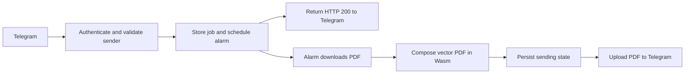

# Rust Worker

This implementation converts PDFs directly in Cloudflare Workers using Rust
compiled to WebAssembly. It uses `workers-rs` for Cloudflare bindings, `lopdf`
for existing PDF objects, and `pdf-writer` for drawing note grids and placing
slides. Source graphics, embedded fonts and images stay in the PDF.

The preview Worker is named `slides-converter-bot-rust`. Both Wrangler configs
pin account `b8c62fa1e9e5506c9a181b9d372a9261`, belonging to
`phanuphat.srisukhawasu@gmail.com`. Authentication must grant access to that
account before a deployment can succeed.

## Local development

From the repository root, install Rust, Node.js, and the pinned build tool:

```sh
rustup target add wasm32-unknown-unknown
cargo install worker-build --version 0.8.7 --locked
npm ci
cp rust-worker/.dev.vars.example rust-worker/.dev.vars
```

Fill in the ignored `.dev.vars` file with your Telegram credentials and allowlist,
then run:

```sh
npm run rust:dev
```

`GET /health` returns JSON identifying the `rust-wasm` runtime. `POST /telegram`
requires the Telegram webhook secret header. Use the mock integration tests for
development that must not contact Telegram.

## Processing flow



The singleton queue processes one PDF at a time. Repeated deliveries use the
same chat/message key and do not create a second job. Completed keys remain for
seven days; job contents are cleared on completion. Pending jobs and duplicate
protection survive runtime restarts.

Alarm retries may repeat work before upload begins. Once `sending` is stored,
the upload is never retried automatically: after a crash, Telegram may already
have accepted it. This prevents repeated file delivery but can leave an
interrupted job without a result. Send a new message to retry it manually.

## Code organization

| Module | Responsibility |
| --- | --- |
| `webhook.rs` | HTTP routing, webhook authentication, sender allowlist, submission |
| `model.rs` | Typed Telegram inputs, pure validation and filename handling |
| `jobs.rs` | Cloudflare lifecycle and the download/convert/send pipeline |
| `queue.rs` | SQLite persistence, claims, send markers and alarms |
| `telegram.rs` | Telegram requests, bounded downloads and multipart uploads |
| `pdf/mod.rs` | The public `convert_pdf(bytes)` interface and composition steps |
| `pdf/layout.rs` | Pure page geometry and slide placement |
| `pdf/drawing.rs` | Typed PDF drawing through `pdf-writer` |
| `pdf/objects.rs` | PDF loading, inherited page data, bounded stream decoding |
| `pdf/annotations.rs` | External hyperlinks and remapped internal destinations |

The PDF conversion interface takes bytes and returns bytes or a typed error. It
does not depend on Cloudflare, Telegram, the filesystem or a clock, so the same
code runs in the native comparison tool and the Worker. Platform resources are
composed in the job handler. Transport and storage interfaces stay concrete;
there is no custom dependency injection framework or trait for every module.

## Validation

Python and Poppler are required for the temporary migration comparisons.
Install Poppler with `brew install poppler` on macOS if `pdftoppm` is unavailable.

```sh
uv sync --dev
make check
```

`make check` runs the legacy tests, Python lint/type checks, TypeScript checking,
Rust formatting and Clippy for native/Wasm targets, rendered PDF comparisons,
and local `workerd` tests with mocked Telegram calls. For just the migration:

```sh
npm run migration:test
```

The native tool can convert a PDF independently:

```sh
cargo run --release --manifest-path rust-worker/Cargo.toml --example convert -- input.pdf output.pdf
```

## Preview deployment and cutover

The source migration has been tested locally. Production still runs the
existing Worker/container implementation until the webhook is switched.

Validate the deployment package without uploading it:

```sh
npm run rust:deploy -- --dry-run
```

Authenticate as `phanuphat.srisukhawasu@gmail.com`, verify `wrangler whoami`, then
deploy the preview Worker:

```sh
npm run rust:deploy
cd rust-worker
npx wrangler secret put TELEGRAM_BOT_TOKEN --config wrangler.toml
npx wrangler secret put TELEGRAM_WEBHOOK_SECRET --config wrangler.toml
npx wrangler secret put ALLOWED_TELEGRAM_USER_IDS --config wrangler.toml
```

After verifying `/health` and representative real slide decks, let the current
bot finish its in-flight jobs. Register the preview Worker's `/telegram` URL
through Telegram's `setWebhook`, using the same secret token and
`allowed_updates=["message"]`. Keep the old Worker available during the trial.
Rollback consists of restoring the prior webhook URL,
`https://otter-slides-converter.phanuphats.com/telegram`, after the Rust queue
has drained. The migration does not delete the existing Durable Object class,
container or its duplicate-delivery records.

## Supported PDFs and limits

- A4 output with up to three slides per page; identical default layout to Python.
- Vector graphics, images, embedded fonts, transparency, crop boxes, inherited
  page resources, page rotations, URI links and named/direct internal links.
- Non-link annotations, including forms and comments, currently require
  flattening. Such inputs are rejected instead of silently losing annotations.
- Encrypted, empty, malformed and oversized PDFs are rejected. PDFs encrypted
  with an empty password are also rejected, matching the Python implementation.
- Input is limited to 20 MB and output to 50 MB. Decoded page content and any
  object/xref stream decoded while loading are limited to 8 MB each.
- Workers have 128 MB of memory, including Wasm and JavaScript allocations.
  CPU is configured up to 300,000 ms on Workers Paid. Local success on a 17.4 MB
  generated deck does not establish a memory guarantee for every real PDF;
  Cloudflare's deployed runtime is the final limit check.
- Alarm execution is independent of the webhook request. It avoids relying on
  `waitUntil()`'s 30-second extension; alarms have a 15-minute wall-time limit.

Use Cloudflare's invocation CPU/wall-time metrics for production performance.
Deployed `Date.now()` and `performance.now()` clocks only advance after I/O, so
an in-code timer around synchronous PDF conversion cannot measure its CPU time.
The benchmark measures elapsed time outside the Worker process; its local
timings remain useful for comparing implementations.

## Official documentation checked

Checked on 18 October 2026 against the current official documentation, using
`worker` / `worker-build` 0.8.7 and Wrangler 4.151.1:

- [Rust on Workers](https://developers.cloudflare.com/workers/languages/rust/)
- [Workers runtime limits](https://developers.cloudflare.com/workers/platform/limits/)
- [Durable Object alarms and retry semantics](https://developers.cloudflare.com/durable-objects/api/alarms/)
- [Durable Object limits](https://developers.cloudflare.com/durable-objects/platform/limits/)
- [Wrangler custom builds](https://developers.cloudflare.com/workers/wrangler/configuration/#custom-builds)
- [Worker performance clocks](https://developers.cloudflare.com/workers/runtime-apis/performance/)
